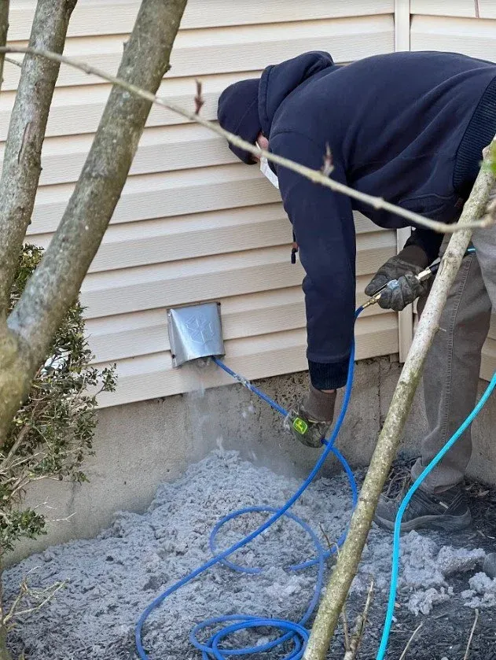

## The short version

- If your clothes need two cycles to dry, a clogged dryer vent is one of the most common reasons.
- Lint builds up in the vent line over time. That restricts airflow, so the dryer runs longer and hotter on every load.
- You can check a few things yourself in about five minutes: the lint trap, the outside vent flap and the connector behind the dryer.
- A dryer vent cleaning covers the full line from the dryer to the outside, plus the transition duct, the exterior opening and an airflow check. It's a flat fee and usually takes under an hour.

## Why a clogged vent makes the dryer take forever

Your dryer works by blowing hot, damp air out of the drum and through the vent line to the outside of the house. Every load sends a little lint along with that air. The lint trap catches most of it, but not all of it. Over months and years, what gets past the trap builds up inside the vent line and at the outside opening.

Once that line starts to clog, the damp air can't get out as fast. The dryer keeps running, the clothes stay damp, and you end up hitting the start button a second time. It's also working harder and hotter than it should on every load, which means more energy used per load and more wear on the dryer.

The photo at the top of this post is an outside vent hood from one of my jobs. The lint is packed in so tight it's holding the flaps open. A dryer hooked up to that is going to struggle.

## Five-minute checks you can do yourself

Before you call anybody, here's what I'd look at.

**1. The lint trap.** Clean it every load. If you haven't been, start there and run a normal load to see if it helps.

**2. The outside vent flap.** Go outside while the dryer is running and find where the vent exits. The flap should open and you should feel warm air coming out. If the flap doesn't open, or you barely feel any air, the line is likely restricted. Lint collecting around the outside flap is another giveaway.

**3. The laundry room.** If the dryer or the laundry room feels hot while it's running, that heat isn't getting out the way it should.

**4. The connector behind the dryer.** Pull the dryer out a little and look at the transition duct, the flexible piece between the dryer and the wall. If it's crushed, kinked or pulled loose, that alone can choke the airflow.

**5. The calendar.** If it's been more than a year since the vent was last cleaned, or you don't know if it's ever been cleaned, it's probably due.

One more: if you notice a burning smell when the dryer runs, don't keep running it and hoping. Get the vent checked.

## Lint trap vs the vent line

A lot of people figure the lint trap handles everything. Here's the difference:

| | Lint trap | Dryer vent line |
|---|---|---|
| Where it is | Inside the dryer door or on top | Behind the dryer, through the wall or floor, to the outside |
| What it catches | Most of the lint, every load | Whatever gets past the trap, building up over time |
| Who cleans it | You, every load | Usually a pro, since most of the line is out of reach |
| How often | Every load | Generally once a year, more often for large households or long vent runs |
| What happens if you skip it | Slower drying right away | Longer dry times, more heat, more wear, higher fire risk |

## Why it's worth taking seriously

Slow drying is annoying, but it's not the main reason I tell people to keep up with their vent. Lint is highly flammable. A clogged vent traps heat and makes the dryer work harder every load. A clogged dryer vent is a common cause of house fires. Regular cleaning is one of the simplest ways to reduce that risk.

So if your dryer's been taking two cycles for a while, treat it as a sign, not just an inconvenience.

## What a dryer vent cleaning covers

Here's what's included when I clean a dryer vent:

- The full vent line cleaned, from the dryer to the exterior
- The dryer transition duct, the connector behind the dryer
- Lint buildup removed from the exterior vent opening
- An airflow check after cleaning
- Before and after photos
- Flat-fee pricing, no surprise charges

That's from one of my jobs, clearing a vent line from the outside. The gray pile on the ground all came out of one dryer vent. Customers are usually surprised by how much there is. Brock B. said it best: "Seeing how much nasty stuff was in the vent was very surprising. Dryer works like a champ now."

Most dryer vent cleanings are quick, usually under an hour. When I'm done, I'll check the airflow and give you a few tips to keep it clear. I like to explain what I found and how your setup works, too. Molly B. mentioned I was "super helpful in helping us understand our system," and that's the goal on every visit.

If your vent exits through the roof instead of a side wall, call me and tell me where it exits. I'll confirm with you before we set anything up.

## What changes after a cleaning

The main benefits are pretty simple:

1. Clothes dry faster
2. Lower energy use per load
3. Reduced fire risk
4. Less wear on your dryer

If the vent is clear and the airflow is good but the dryer still takes forever, the problem may be the dryer itself. At that point it's a job for an appliance repair company. I clean vents and ducts. I don't repair dryers.

## Getting it done

Dryer vent cleaning is a flat fee. Call me at (816) 655-8105 for a quote. I'm often able to come out the next day, and you'll get a reminder with an arrival time before I show up. I do the work myself, no subcontractors. I work across the Kansas City suburbs on both sides of the state line, from Liberty, Gladstone and Parkville to Overland Park, Olathe and Lee's Summit. The [service area page](/service-area/) has the full list.

If you're thinking about having your air ducts cleaned too, I can do both in one visit. A lot of customers do. You can read more on the [dryer vent cleaning page](/services/dryer-vent-cleaning/) or [request a free quote](/quote/) and I'll get back to you.

Selling a house or finishing a remodel? I also check that dryer vents are clear and properly connected before move-in or listing.

## FAQ

**Why is my dryer taking so long to dry clothes?**
A clogged dryer vent is one of the most common causes. Lint buildup restricts airflow, so the dryer runs longer and hotter. More on our [FAQ page](/faq/).

**How often should I clean my dryer vent?**
Generally once a year. More often for large households or long vent runs.

**Is a clogged dryer vent dangerous?**
Yes. Lint is highly flammable, and a clogged vent traps heat. Regular cleaning is one of the simplest ways to reduce fire risk.

**How long does a dryer vent cleaning take?**
Usually under an hour.

**How much does it cost?**
It's a flat fee. Call (816) 655-8105 for a quote. The price you're quoted is the price you pay.

**Do you clean roof-exit dryer vents?**
Call (816) 655-8105 and tell me where your vent exits. I'll confirm with you.

**Can you clean my dryer vent and air ducts in the same visit?**
Yes, and many customers do both at once. See [air duct cleaning](/services/air-duct-cleaning/) for what that covers.

**Do I need to be home?**
Yes, for access and a quick walkthrough when I'm done. It helps to clear a path to the dryer and secure pets if you can.
