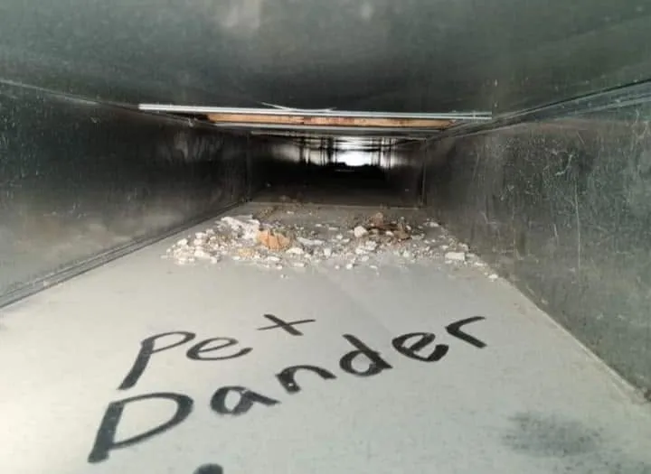

## The short version

- Construction dust gets into ductwork. Drywall sanding and floor sanding are the big ones.
- Clean the ducts after the dusty work is done, not before. If you clean too early, the dust just ends up right back in them.
- The best window is usually after drywall, sanding and floor refinishing, and before you move in, list the house or hand over the keys.
- Have the dryer vent checked at the same time. On a new build or a remodel, you want to know it's clear and connected.
- Builders, remodelers and flippers: I do post-construction and pre-sale cleanings with fast turnaround for project timelines.

## Why construction dust ends up in the ducts

Any project that makes dust puts some of it in the ductwork. Sanding drywall mud is the classic example. That fine powder floats everywhere, and the return vents pull it right in. Floor sanding does the same thing, and so does cutting trim, tile and cabinets inside the house.

If the system was running during the work, that dust has been moving through the ducts the whole time. Even if it wasn't, the vents are open holes in the floor and walls, and dust settles into them.

It doesn't go away on its own. When the heat or air comes on after the project, whatever settled in there gets blown back into the clean new rooms.

## The most common timing mistake

It's cleaning too early. People want the house fresh before the furniture comes in, so they schedule the duct cleaning in the middle of the project. Then the floor guy shows up and sands for two days.

I'll be honest with you about timing, even if it means turning down the job for now. One customer had me out while his project was still going:

> "He noticed I was still installing some drywall and needed to sand the floors. He turned my money down and recommended that I finish first, then get my duct work cleaned. I appreciate the up front honesty." Romond H.

That's the right call every time. Cleaning ducts before the dusty work is finished means paying to clean them twice.

## The timing checklist

Here's how I'd line it up on a typical remodel or new build.

| Project stage | Clean the ducts now? | Why |
|---|---|---|
| Demo and framing | No | The dustiest work is still ahead |
| Drywall hung, mud and sanding underway | No | Sanding dust is the main thing you're trying to get out |
| Floors being sanded or refinished | No | Same story. Wait until it's done |
| Trim, tile and cabinets going in | Not yet | Cutting and fitting still make dust |
| Dusty work done, final clean done | Yes | This is the window |
| Before move-in, listing or handover | Yes | Clean ducts before anyone lives in it |
| Already moved in and noticed dust | Yes, it's not too late | Better late than never |

**A few things that help during the project:**

- **Ask your contractor about covering vents** while the dusty work is happening. It cuts down on how much gets in, though some always does.
- **Change the furnace filter** after the dusty work is done. It's probably been working overtime.
- **Tell me what was done** when you call. Drywall, floors, a gut job or a small bathroom remodel are all different amounts of dust.

## Don't skip the dryer vent

On a remodel, the laundry room often gets moved, rebuilt or opened up. On a new build, the vent line was put in by somebody you'll never meet. Either way, it's worth having it checked.

A dryer vent cleaning covers the full line from the dryer to the outside, the transition duct behind the dryer and the lint at the exterior opening. I check the airflow when I'm done, so you know it's clear and connected before anyone starts running loads. It's a flat fee and usually takes under an hour. More on that on the [dryer vent cleaning](/services/dryer-vent-cleaning/) page.

## What I clean after construction

A post-construction cleaning is the same thorough job as any air duct cleaning:

- Supply vents and registers
- Return vents and ducts
- Main trunk lines
- The blower compartment area
- Before and after photos so you can see what came out
- Cleanup of the work area before I leave

All air duct cleaning is performed to NADCA standards. And it's me doing the work, not a subcontractor.

If I find ductwork that got knocked loose or disconnected during the project, which happens on remodels, I'll show you photos and give you a price before anything gets done. I can usually reattach loose ductwork or tape small holes on the spot. For major duct repairs, I'll refer you to another company.

## For builders, remodelers and flippers

If you build, remodel or flip houses around Kansas City, I handle post-construction, post-remodel and pre-sale duct cleaning with fast turnaround for project timelines. A few notes:

- **Schedule it after the final dusty trade.** I'd rather come once at the right time.
- **Before photos and after photos come with every job.** They're handy to share with a buyer or a homeowner.
- **The dryer vent gets checked** so it's clear and connected before move-in or listing.
- **Pricing is simple.** It's based on the number of vents and the size of the home, and I can usually give you an upfront price over the phone. The price you're quoted is the price you pay.

Real estate agents refer buyers and sellers to me, too. If you've got a listing coming off a remodel, it's an easy box to check, and the before and after photos give buyers something real to look at. If you just bought one, see my post on [duct cleaning when you move into a new house](/blog/duct-cleaning-moving-into-new-house/).

## For homeowners finishing a project this winter

A lot of people squeeze in a remodel before the holidays. If that's you, here's the simple version: let the contractors finish, do your final clean, then call me before the family shows up. Most homes take about 2 hours, and I can often come out the next day depending on the schedule.

## Duct cleaning after construction FAQs

**Should I clean the ducts before or after a remodel?**
After the dusty work, like drywall and floor sanding, is finished. Cleaning before that means the dust will just end up back in the ducts.

**Do new construction homes need duct cleaning?**
A new build has had a lot of drywall, sanding and cutting done inside it, so construction dust in the ducts is common. Cleaning before move-in or listing makes sense.

**Do you work with builders, remodelers and flippers?**
Yes. I handle post-construction, post-remodel and pre-sale duct cleaning with fast turnaround for project timelines.

**How long does it take?**
Most homes take about 2 hours for the air ducts. A dryer vent usually takes under an hour.

**Can you do the dryer vent in the same visit?**
Yes, and many customers do both at once.

**Will it be messy?**
No. The work area is cleaned up before I leave.

## Finishing a project? Let's time it right

Call (816) 655-8105 and tell me where the project stands. If it's too early, I'll tell you. When it's time, [request a free quote](/quote/). You can read more about [air duct cleaning](/services/air-duct-cleaning/) or check the [FAQ](/faq/).
