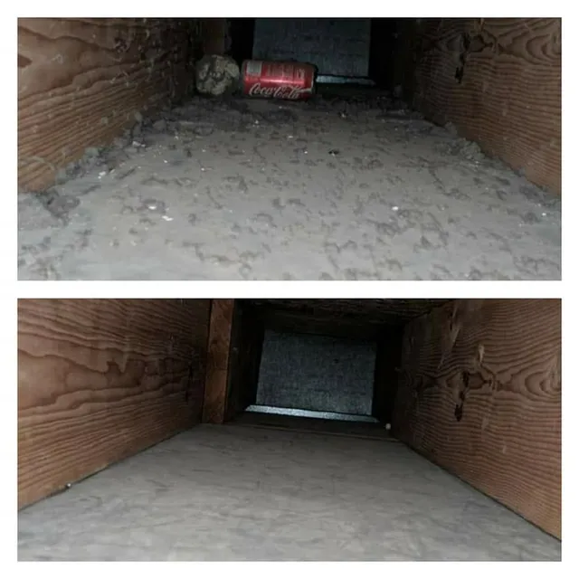

## The short version

- If you want the ducts and the dryer vent cleaned before a new baby comes home, call earlier than you think, not the day you go into labor.
- I clean both on the same visit when that helps: air ducts performed to NADCA standards, plus the dryer vent.
- I give you an upfront price over the phone. No hidden fees. The price you're quoted is the price you pay.
- I do the work myself. You'll see before and after photos. All work is guaranteed.
- You do need to be home. Clear a path to the vents, the furnace, and the dryer, and secure pets if you can.

## Why people call me before a baby comes home

This is a nesting job, not a medical one. A lot of Kansas City families want the house in order before a new baby arrives: less dust in the vents, a dryer vent that isn't packed with lint, one less thing to think about after the due date. I can do that work. What I won't do is make health claims about it. If you have health questions, talk to your doctor.

People do call me for this. Sometimes it's planned weeks out. Sometimes it's tight, like a family that needed the ducts cleaned before their firstborn came home that evening. I will be honest about the schedule. I can often come out the next day, depending on what's already on the book. I won't promise a same-day emergency visit in this post.

I work across the Kansas City metro on both sides of the state line, including places like Liberty, Gladstone, Parkville, and Overland Park. If you're not sure whether I cover your town, ask when you call.

I'm also going to tell you if the job isn't worth doing yet. If you just had the ducts cleaned, or if you're in the middle of a remodel and the dust isn't done, we should wait. I'd rather come out when the work will actually take, instead of cleaning a system that's about to get dirty again. That's part of getting the house ready too: pick a window after the construction is finished, and before the due date, not during the drywall.

The dryer vent is the same kind of decision. If you already know it's been a long time, or the dryer is taking longer than it should, that's a good reason to add it to the visit. If you just had it cleaned, we can skip it and just do the ducts. Call me and we'll figure out the window that actually makes sense for your house and your due date.

## What I actually clean

On an [air duct cleaning](/services/air-duct-cleaning/) visit, I clean the system: supply vents and registers, returns, trunk lines, and the blower compartment. The work is performed to NADCA standards. I show you before and after photos so you can see what came out.

The [dryer vent](/services/dryer-vent-cleaning/) is a separate piece of work, and it's worth doing before a new baby because that dryer is about to run more, not less. I can usually do the ducts and the dryer vent in one visit. Most homes take about two hours for the ducts. The dryer vent is usually under an hour.

If you're making a list, here's the order I'd use. Finish any painting or construction in the nursery first. Then book the ducts, and add the dryer vent if it's been a while. Then move the crib in and set up the room. That way the dust from the project isn't sitting in the vents when you're done, and you're not trying to schedule a service visit with a newborn in the house.

## How the visit works when you're getting the house ready

Call (816) 655-8105 or [request a quote](/quote/). I answer the phone, I give you the price, and I'm the person who shows up. No subcontractors or rotating crews.

You do need to be home, both so I can get in and so we can do a quick walkthrough when the job is done. To prepare, clear a path to your vents, the furnace, and the dryer, and secure pets if you can. That's the same prep I ask of every job. There's a little more on that on the [FAQ](/faq/) page.

If something isn't right, I'll make it right. That's the guarantee. I don't leave you with a surprise bill. The price you're quoted is the price you pay, and I don't hide fees in the visit.

A same-visit job is straightforward. I need access to the vents, the furnace or air handler, and the dryer. If the dryer is in a tight closet, or the furnace is in a crawl space I need to know about, tell me when we talk. I'll plan the time around that. You don't need to empty the whole house. You do need those paths clear.

People sometimes ask whether they should try to vacuum the vents themselves first. You can dust a register cover. That's not the same as cleaning the system, and it's not a reason to skip the appointment or to wait until after the baby is home. If the house has been through a remodel, or it's a place that's been closed up, say that too. Dust from construction is one of the reasons families call before they move a crib in. I'm not going to turn that into a bigger claim than it is. It's dust, and I clean it out of the ducts.

If your due date is close, say so when you call. I'll tell you what I can actually do with the days we have. Don't wait until you're on the way to the hospital and hope I can swing by that night. If I can't fit the visit in before your date, I'll say so. I'd rather be straight with you than have you count on a day I don't have.

## FAQ

**Should I get the air ducts cleaned before a new baby comes home?**
A lot of families want that done as part of getting the house ready. I can clean the ducts and the dryer vent beforehand. I won't make health claims about it.

**How soon can you come out?**
Often the next day, depending on the schedule. Call (816) 655-8105 and I'll tell you what's open.

**Do I need to be home?**
Yes, for access to the home and a quick walkthrough when the job is done.

**How do I prepare for the appointment?**
Clear a path to your vents, furnace, and dryer, and secure pets if possible.

**Who does the work?**
I do. Derek Craig, the owner. No subcontractors.

**Do you give an upfront price?**
Yes. Upfront price over the phone, no hidden fees. The price you're quoted is the price you pay. I don't list dollar amounts on this page.

## Call or request a quote

If you want the ducts and the dryer vent cleaned before a new baby comes home, call me at (816) 655-8105 or [request a free quote](/quote/). I'll tell you the price, the timing, and whether I can do both in one visit.
