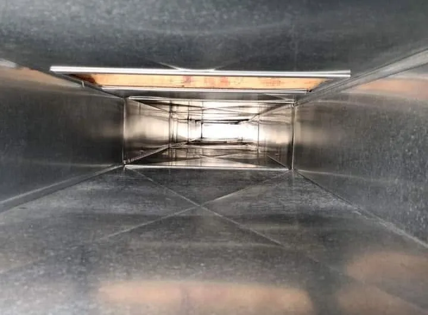

*By Derek Craig, owner of Duct Hunt*

## The short version

- A little dust and a faint burning smell the first time the heat runs each fall is common. It usually fades pretty quickly.
- If the house stays dustier all season, start with the furnace filter. It's the cheapest fix and the first thing I'd look at.
- If you've got a fresh filter and you're still dusting every day, or you notice a musty smell, weak airflow, or you have no idea when the ducts were last cleaned, the ducts are probably part of it.
- An air duct cleaning covers the supply vents, returns, main trunk lines and the blower compartment area. Most homes take about 2 hours, and you get before and after photos.

## Why the dust shows up when the furnace kicks on

All summer the furnace sits there, and dust settles inside the system. Then the first cold morning hits, the heat comes on, and the blower starts pushing air through every duct in the house again. Whatever settled in there gets a ride into your living room. In a typical suburban house, that's a lot of ductwork: supply runs to every room, the returns, and the main trunk lines tying it all together.

The windows are shut, the system is running more, and the same air gets moved around the house over and over. If your ducts have a layer of dust, pet hair or leftover construction debris in them, the system keeps sending a little of it back into every room.

Take a look at the photo at the top of this post. That's the inside of a dirty duct, and somebody wrote "pet dander" right in the dust. That's the kind of thing that sits in the ductwork, out of sight, every time the system kicks on.

## What's normal and what isn't

Here's how I'd sort it out:

| What you notice | Probably normal | Worth a closer look |
|---|---|---|
| Faint dusty or burning smell | The first day or two the heat runs | Still there weeks later, or it smells musty or stale |
| Dust on furniture | A bit more than summer | Coming back a day or two after you dust |
| Airflow from vents | About what it was last winter | Weak from some vents, or weaker than it used to be |
| Your house's history | Ducts cleaned in the last few years | You moved in and don't know, or they've never been cleaned |
| Recent projects | Nothing dusty lately | A remodel, drywall or floor sanding since the last cleaning |

If you're mostly in the left column, you're probably fine. Change the filter and keep an eye on it. If a few things in the right column sound familiar, keep reading.

## Check the filter first

I'm not going to tell you to call me before you've checked the filter. Pull it out and look at it. If it's gray and caked, swap it. The size is usually printed on the edge of the old one. I'm always happy to talk filters when I'm at a house. Ron S. put it this way after his cleaning: "We can already tell a difference with our dust factor and furnace does not seem to be working as hard. I was given some good advice about filters."

A new filter helps with what's floating around from here on out. It doesn't do anything about what's already built up inside the ducts.

## Signs your ducts are part of the problem

These are the same signs I list on the [air duct cleaning page](/services/air-duct-cleaning/), with a little more detail:

**Dust builds up fast after you clean.** You dust on Saturday and it's back by Monday. Nick A. said it plainly: "Dusting every day was wearing on us."

**A musty or stale smell when the system runs.** Not the one-time burnoff at the start of the season. A smell that shows up every time the heat comes on.

**Weak airflow from some vents.** One bedroom never seems to get as much air as the others.

**You recently remodeled or did drywall work.** Drywall and sanding dust get everywhere, including into the returns. If you cleaned the house but not the ducts, a lot of that dust is still in the system.

**You moved into a home and don't know when the ducts were last cleaned.** This one comes up all the time.

**You have pets, smokers or allergy sufferers in the home.** Pet hair especially finds its way into returns.

**Your home is older and the ducts have never been cleaned.** Plenty of houses I work in have never had the ducts touched. Amanda T. told me, "Our home was built in '79 and has NEVER been cleaned!"

If two or three of these fit your house, a cleaning is probably worth it. If only one does and it's mild, you can likely wait. Generally I tell people every 3 to 5 years, and sooner if you've remodeled, have pets or have allergy sufferers in the home.

## What a cleaning actually takes care of

When I clean a home's ducts, here's what's included:

- All supply vents and registers
- Return air vents and ducts
- Main trunk lines
- The blower compartment area
- Before and after photos of your ducts
- Cleanup of the work area when I'm done
- Filter recommendations and maintenance tips

The work is performed to NADCA standards. For most homes it takes about 2 hours. Kyle L. had all the ducts and returns in his 3,000 square foot home cleaned in under 2 hours.

The before and after photos are a big deal to me. You shouldn't have to take my word for it. Here's the after shot of that same duct.

If I spot something small while I'm in there, like a loose or disconnected section of duct or a small hole that needs taping, I can usually fix it on the spot. I'll tell you the price before I do it. Bigger repairs I refer out.

## What people tell me afterward

Every house is different, so I won't promise a specific result. The most common thing customers tell me is there's less dust around the house. Some notice the air smells fresher. That lines up with the main benefits I list: less dust, fresher-smelling air, better airflow and an HVAC system that doesn't have to work as hard.

## Getting it scheduled

Pricing is based on the number of vents and the size of your home, so I can usually give you an upfront price over the phone. No in-home estimate needed. The price I quote is the price you pay, and if there's an optional add-on that might help, I'll explain it and let you decide. No pressure either way.

I answer the phone, give the quote and do the work myself. No subcontractors and no rotating crews. I'm often able to get out the next day, and you'll get a reminder with an arrival time before I show up.

I work across the Kansas City suburbs on both sides of the state line, from Liberty, Gladstone and Parkville to Overland Park, Olathe and Lee's Summit. The [service area page](/service-area/) has the full list.

Call me at (816) 655-8105 or [request a free quote](/quote/) and I'll get back to you. If you'd like to add your dryer vent while I'm there, I can do both in one visit.

## FAQ

**How do I know if my ducts need cleaning?**
The common signs are dust building up quickly, a musty smell when the system runs, weak airflow, a recent remodel, or not knowing when they were last cleaned. If a fresh filter didn't fix the dust, the ducts are a good next place to look. There's more on this on our [FAQ page](/faq/).

**Is some dust normal when the heat first comes on?**
A little dust and a faint burning smell the first time the furnace runs for the season is common, and it usually fades quickly. Dust that keeps coming back all season is a different story.

**How often should I have my air ducts cleaned?**
Generally every 3 to 5 years. Sooner if you've remodeled, have pets or have allergy sufferers in the home.

**How long does it take?**
Most homes take about 2 hours, depending on size and number of vents.

**Will it be messy?**
No. I clean up the work area before I leave.

**Do I need to be home?**
Yes, for access to the house and a quick walkthrough when the job is done. Before I get there, clear a path to your vents, furnace and dryer, and secure pets if you can.

**Will I see a difference?**
Many customers notice less dust and fresher-smelling air. Either way, you'll get before and after photos so you can see exactly what came out.

**Can you clean my dryer vent at the same visit?**
Yes, and a lot of customers do both at once. See [dryer vent cleaning](/services/dryer-vent-cleaning/) for what that covers.
