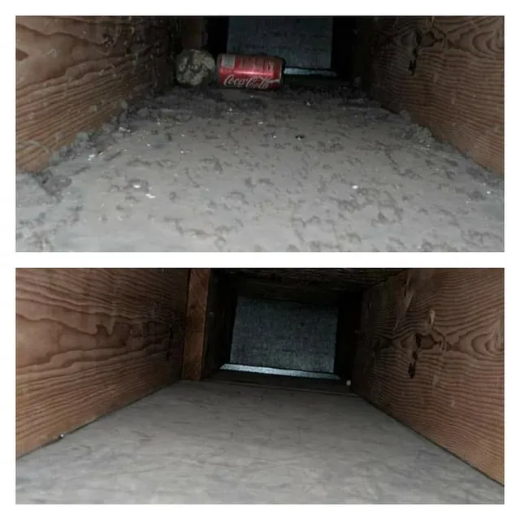

## The short version

- Ask who actually does the work. The person on the phone and the person in your house aren't always the same.
- Ask how the price is figured and whether that's the price you'll pay. Get it before anyone shows up.
- Ask what's included. Supply vents, returns, trunk lines and the blower area should all be on the list.
- Ask about upsells and add-ons up front, and whether they'll show you before and after photos.
- A good company answers all of this easily. If the answers get fuzzy, keep calling around.

## Why it's worth asking a few questions first

Most people hire an air duct cleaner once every few years, if that. You don't have a go-to guy the way you might for a plumber. So you search, you call a couple of numbers and you pick one.

The problem is the companies don't all work the same way. Some quote over the phone, some want to come out first. Some send whoever's on the schedule that day. Some show up with a low number and then spend the visit talking you into extras.

None of that is obvious until you ask. Here's what I'd ask if I were the one hiring.

## 1. Who's going to be doing the work?

This one matters more than people think. Ask whether the person quoting you is the person showing up, or whether the job goes to a crew or a subcontractor you'll meet that morning.

At Duct Hunt, it's me. I answer the phone, give you the quote and do the work myself. No subcontractors or rotating crews. That way the person who promised you a price and a time is the same person who shows up at your door.

Not every good company works that way, and that's fine. But you should know who's coming into your house, and who you call if something isn't right.

## 2. How do you figure the price, and is that what I'll pay?

You want two things here: how the price is calculated, and a clear answer on whether it can change.

For air duct cleaning, I price on the number of vents and the size of your home. Most of the time I can give you an upfront price over the phone, with no in-home estimate needed. One customer put the difference this way:

> "He was able to tell me how the process works and the pricing. Other companies I called said they would have to come out and estimate the home." Angela T.

There's nothing wrong with a company that wants to see the house first. Some homes really are tricky. But ask what happens to the number once they're inside.

The answer you want is simple: the price you're quoted is the price you pay, with no hidden fees. Here's how Kyle L. described it after his visit:

> "There were no surprise fees involved, the previously agreed upon price was what I paid!" Kyle L.

Dryer vent cleaning is even simpler. It's a flat fee. Call for a quote.

## 3. Will you try to sell me add-ons?

Just ask it straight. "Are you going to try to upsell me?" A decent company won't be offended.

My answer: no. If there's an optional add-on that might help your home, I'll explain it and let you decide. There's never any pressure. If I find damage while I'm there, I'll show you photos, explain the problem and give you a price before anything gets done. Small fixes like taping a hole or reattaching a loose section I can usually handle on the spot. For major duct repairs, I'll refer you to another company.

Be careful of anyone who quotes a number that sounds too good and then spends the visit finding problems. Ask about extras before they arrive.

## 4. What exactly is included?

"Duct cleaning" can mean very different jobs depending on who you hire. Ask for the list. Here's what an air duct cleaning with me covers:

| What's included | Why it matters |
|---|---|
| Supply vents and registers | Where the air comes into each room |
| Return vents and ducts | Where a lot of the dust collects |
| Main trunk lines | The big ducts that feed the rest of the system |
| Blower compartment area | Dust here gets pushed through the whole house |
| Before and after photos | So you can see what came out |
| Cleanup of the work area | You shouldn't be cleaning up after the cleaner |
| Filter recommendations and tips | So it stays cleaner longer |

All air duct cleaning is performed to NADCA standards.

If a company's answer is vague, or it sounds like they're only cleaning the vent covers, ask more questions.

## 5. Will you show me before and after photos?

You can't see inside your ductwork. Photos are how you know the job got done.

I take before and after photos on every job and walk you through them before I leave. One customer, Andy X., said I "showed me before and after pictures of my vents," and that's how it should go every time.

## 6. How long will it take, and do I need to be home?

Ask so you can plan your day. Most homes take me about 2 hours for the air ducts. A dryer vent usually takes under an hour. You'll need to be home for access and a quick walkthrough at the end.

It also helps to ask how soon they can come out. I can often come the next day, depending on the schedule, and you'll get a reminder with an arrival time before the appointment.

## 7. Is the work guaranteed?

Ask what happens if something isn't right after they leave. My answer is simple: all work is guaranteed. If something isn't right, I'll make it right.

## 8. Do you actually come out to my area?

Ask whether your address is in their regular area and whether there's a trip fee. Duct Hunt is based in North Kansas City and has been cleaning ducts around the metro since 2017. For a trip fee question on your address, give me a call and I'll confirm.

## Red flags to watch for

- They won't explain how the price is figured.
- The price changes once they're inside, and they can't tell you why.
- They can't say who's coming to your house.
- No list of what's included.
- No before and after photos.
- Pressure to decide on extras right now.

## A good sign: they answer your questions easily

The best test is how the call goes. If the person on the phone explains the process, gives you a straight answer on price and doesn't rush you, that's usually how the visit goes too.

> "He answered my questions without hesitation and was very knowledgeable." John S.

You can read more from customers on the [reviews page](/reviews/) or see more about how I work on [why Duct Hunt](/why-duct-hunt/).

## FAQs about hiring an air duct cleaning company

**How much does air duct cleaning cost?**
It's priced on the number of vents and the size of your home. Call (816) 655-8105 and I can usually give you an upfront price over the phone. The price you're quoted is the price you pay.

**Are there any hidden fees?**
No.

**Will you try to upsell me?**
No. If there's an optional add-on that might help, I'll explain it and let you decide.

**Do you follow industry standards?**
Yes. Air duct cleaning is performed to NADCA standards.

**Who does the work?**
I do. Derek Craig, the owner. No subcontractors or rotating crews.

**Can you do the dryer vent in the same visit?**
Yes, and many customers do both at once.

## Ready to ask me those questions?

Call (816) 655-8105 or [request a free quote](/quote/). You can also see what's included in [air duct cleaning](/services/air-duct-cleaning/) or check the [FAQ](/faq/) for anything I didn't cover.
