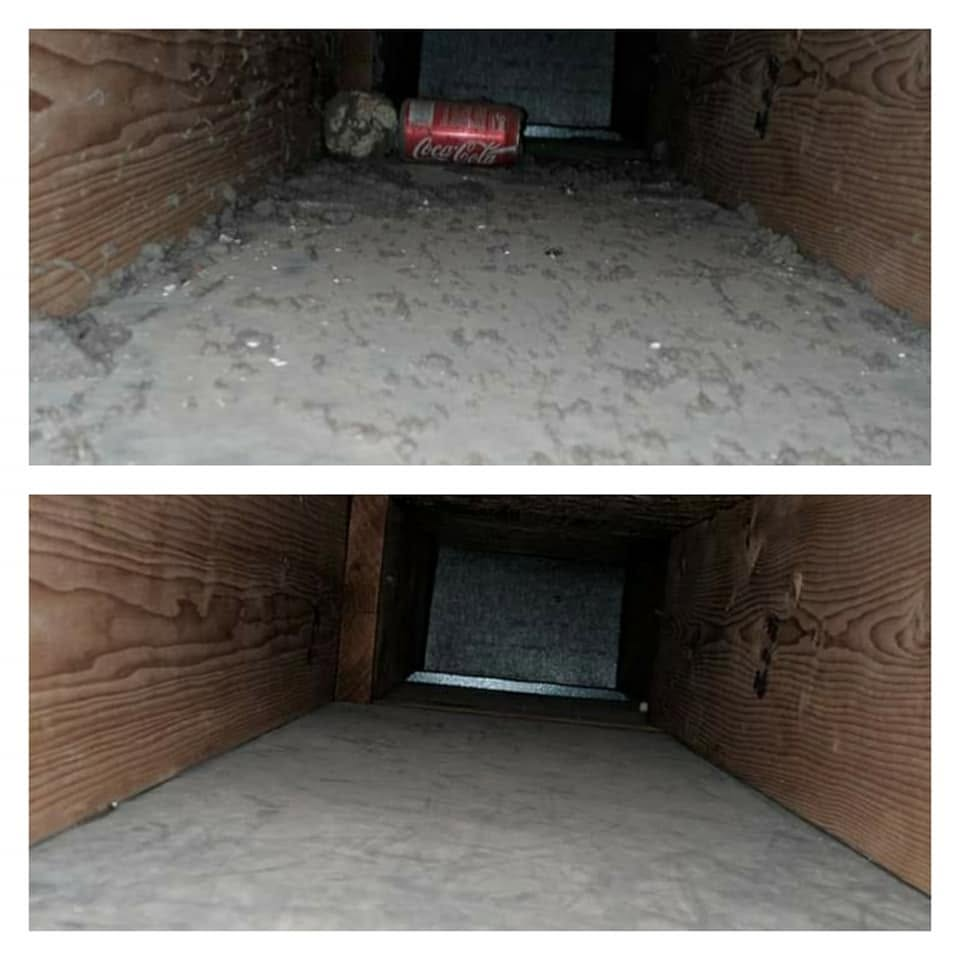

If you have never had the ducts cleaned, the visit can feel like a mystery: who shows up, how long you're without the house, and whether the job is actually the whole system or just the vent covers. This is the visit in order, from the first phone call to the walkthrough at the end.

I'm Derek Craig, the owner of Duct Hunt. I answer the phone, I give you the price, and I do the work myself. No subcontractors and no rotating crew. Air duct cleaning is performed to NADCA standards. You get an upfront price over the phone, no hidden fees, before and after photos, and all work is guaranteed. If something isn't right, I'll make it right.

[Get a Free Quote](/quote/), or call (816) 655-8105.

The short answers already live on our [FAQ](/faq/). The [air duct cleaning](/services/air-duct-cleaning/) page covers what's included. This post is the longer walk through the day itself.

## 1. The quote, over the phone

You do not need an in-home estimate for a normal house. Call (816) 655-8105 and tell me about the home: roughly how many supply and return vents you have, the size of the house, and how easy the ducts and the blower compartment are to reach. If you also want the dryer vent cleaned on the same visit, tell me that too. Dryer vent cleaning is a flat fee, so it's simple to add, and I can often do both in one trip.

I can usually give you an upfront price on that call. The price you're quoted is the price you pay. No hidden fees. I don't publish prices in this post because every house is a little different, and I'd rather quote yours than guess.

If there are optional add-ons that might help, I'll explain them and let you decide. There's no pressure, and the person who quotes the job is the person who shows up.

## 2. Scheduling, and the reminder before I arrive

I can often come out the next day, depending on what's already on the book. I will not promise a particular arrival window in this post. Call and I'll tell you what's open.

You do need to be home, both so I can get into the house and so we can do a short walkthrough when the job is done. Before the appointment, I'll send a reminder with an arrival time so you're not waiting around all day.

## 3. A little prep makes the visit easier

You don't need to deep-clean the house before I get there. A few simple things help:

- Clear a path to the supply and return vents, the furnace, and the dryer if we're doing that too
- Move small furniture or storage that's blocking a vent or the blower area
- Secure pets if you can

That's it. I'll take it from there, and I clean up the work area before I leave.

A tight hallway or a furnace in a crowded utility room just takes a little more setup. If access is awkward, tell me on the quote call so the price and the time estimate aren't a surprise. You don't need to empty the whole house.

## 4. The cleaning itself

This is a full-system cleaning, not a wipe of the vent covers you can see. Performed to NADCA standards, the visit covers:

- All supply vents and registers
- Return air vents and ducts
- The main trunk lines
- The blower compartment

Most homes take about 2 hours, depending on the size of the house and the number of vents. I'll work through the system methodically so we're not skipping the parts people don't look at.

That's the difference between a real cleaning and a visit that only knocks dust off the covers. If a company never opens the returns, never gets into the trunk lines, and never looks at the blower, you didn't get the system cleaned. I'll tell you what I actually did, and you'll have photos from inside the ducts, not just a shiny register.

You can stay in the house. I'll be moving from area to area, and I'll let you know if I need a room cleared for a few minutes. You don't have to leave for the day.

If I spot a small issue while I'm in the ducts, such as a small hole, a loose section, or a disconnected run I can reattach on the spot, I'll show you and talk through it. I am not a duct repair company. For anything major, I'll refer you to someone who is.

The dryer vent, if you added it, is the full line: from the dryer, through the transition duct, to the exterior opening, then an airflow check. If your vent exits in a place I need to confirm, tell me when you call. I won't promise a roof-exit or a special access situation in this post.

## 5. Before and after photos

Every job gets documented. I'll take photos so you can see what was in the ducts and what they look like when I'm done. You are not taking my word for it. You can look at the pictures.

That's also how I keep the visit honest. If I find something worth talking about, the photo is part of that conversation, not a surprise on a later bill.

## 6. Cleanup, then a walkthrough

The work area is cleaned up before I leave. You shouldn't be left with a mess in the hallway or around the furnace.

Then we walk through the results. I'll show you the photos, talk through what I cleaned, and give you filter recommendations and simple maintenance tips if they're useful. This is also when we settle any question about the work itself. All work is guaranteed. If something isn't right, I'll make it right.

## What this visit is, and is not

This is a cleaning visit for the air ducts in a home, and the dryer vent if you asked for it. I work on houses in the Kansas City metro. I won't claim that duct cleaning treats an illness or replaces a doctor's advice.

Many people notice less dust and better airflow after a cleaning. You'll also have the photos, which is the part I can actually show you.

If you just had the ducts cleaned, or you're in the middle of a remodel and the dust isn't done, tell me. We may want to wait. I'd rather come out when the work will actually take.

## After I leave

If you had a question during the walkthrough, you can still call me. The guarantee doesn't end when I pull out of the driveway. If something isn't right, I'll make it right.

If we talked about a filter change or a dryer vent schedule, that's yours to keep up with. I can remind you what we discussed, but I won't invent a maintenance contract in this post. When you're ready for the next cleaning, call and we'll look at the timing for your house.

## FAQ

**Do I need to be home?**
Yes, for access and for the walkthrough at the end.

**Who does the work?**
I do. Derek Craig, the owner. No subcontractors.

**How long does it take?**
Most homes take about 2 hours, depending on size and the number of vents.

**Will it be messy?**
I clean up the work area before I leave.

**Are there hidden fees?**
No. The price you're quoted is the price you pay.

**Is the work guaranteed?**
Yes. All work is guaranteed. If something isn't right, I'll make it right.

## Call for an upfront price

If you want to know what the visit will look like in your house, [request a quote](/quote/) or call (816) 655-8105. I'll give you an upfront price over the phone and walk you through the rest from there.

---
